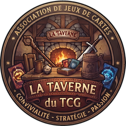

# La Taverne du TCG

**Tournois, ligues et vie de l'association, pour les jeux de cartes à collectionner.**
Application de bureau Windows, hors ligne.

### [⬇️ Télécharger la dernière version](https://github.com/La-Taverne-du-TCG/app.releases/releases/latest)

---

Ce dépôt sert uniquement à **distribuer** l'application : il contient les installeurs et les mises à jour. Le code source est privé.

## 📥 Installation

1. Ouvrez la [dernière version](https://github.com/La-Taverne-du-TCG/app.releases/releases/latest).
2. Dans **Assets**, téléchargez `La.Taverne.du.TCG_X.Y.Z_x64-setup.exe`.
3. Lancez l'installeur et suivez les étapes.

> **Windows affiche « Windows a protégé votre ordinateur » ?** L'installeur n'est pas signé par un certificat de développeur Microsoft, ce qui déclenche cet avertissement pour les petites applications. Cliquez sur **Informations complémentaires**, puis **Exécuter quand même**. Les mises à jour, elles, sont signées et vérifiées par l'application avant d'être installées.

**Configuration requise** : Windows 10 ou 11 (64 bits), écran de 1280 × 720 minimum. WebView2 est déjà présent sur Windows 11 et installé automatiquement si besoin sur Windows 10.

## 🔄 Mises à jour

Inutile de revenir ici : l'application vérifie elle-même les nouvelles versions au démarrage (ou depuis **Paramètres → Mises à jour**) et les installe en un clic, notes de version comprises. Vos données sont sauvegardées automatiquement avant chaque mise à jour.

Pour installer une version précise, toutes les versions restent disponibles dans la page [Releases](https://github.com/La-Taverne-du-TCG/app.releases/releases).

## ✨ Ce que fait l'application

| | |
|---|---|
| 🏆 **Tournois** | Ligue (rondes suisses ou toutes rondes), élimination directe, double élimination, hybride (rondes suisses puis TOP X). Barème et départages configurables, arbre d'élimination, export CSV et impression. |
| 📅 **Ligues** | Ligues annuelles pour plusieurs jeux : saisons, inscriptions des adhérents, soirées avec tirage sans revanche, scores en BO1 à BO9, classement avec points de présence et bonus. |
| 👥 **Association** | Adhérents et adhésions par saison (expiration au 1er septembre, rappel de renouvellement), feuille de présence avec invités, statistiques de fréquentation. |
| 📺 **Affichage** | Écran de projection en direct : podium, classement, appariements, derniers résultats, avec défilement entre plusieurs compétitions. |
| 🛡️ **Vos données** | Tout reste sur votre PC. Sauvegardes automatiques avant chaque action sensible, restauration en un clic, export chiffré `.taverne` pour changer d'ordinateur. |

Le détail de chaque version est dans les notes des [Releases](https://github.com/La-Taverne-du-TCG/app.releases/releases).

## 💾 Où sont mes données ?

Dans `%APPDATA%\asso.ltt.tcgapp\` : la base de l'application et le dossier `sauvegardes-auto`. Désinstaller l'application **conserve** ces données, sauf si vous cochez la case de suppression des données pendant la désinstallation.

Pour changer de PC : **Paramètres → Base de données → Exporter**, puis **Importer** le fichier `.taverne` sur le nouveau poste.

## 🔐 Sécurité

Vous pensez avoir trouvé une faille de sécurité ? Ne la décrivez pas dans une issue publique : utilisez le [signalement privé de faille](https://github.com/La-Taverne-du-TCG/app.releases/security/advisories/new) de ce dépôt (compte GitHub requis), ou prévenez directement le bureau de l'association.

---

Développé par **Matheol** pour l'association **La Taverne du TCG** — tous droits réservés.

